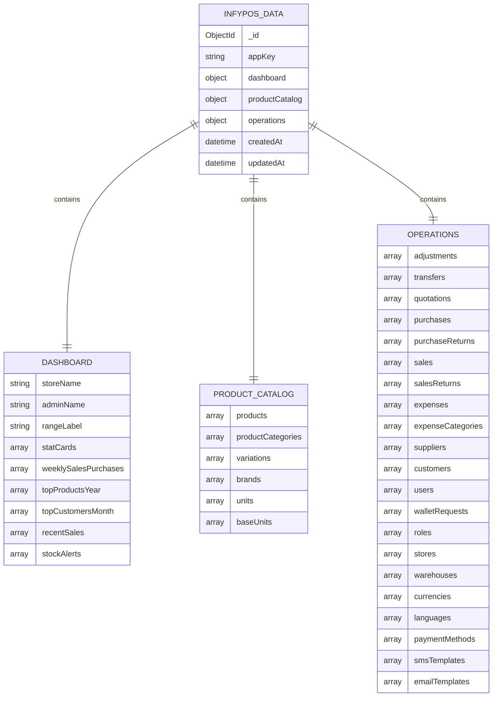
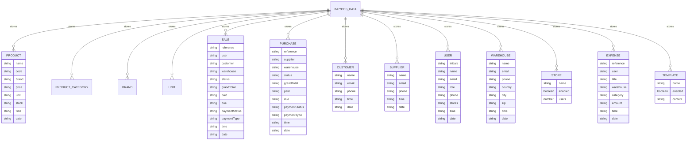
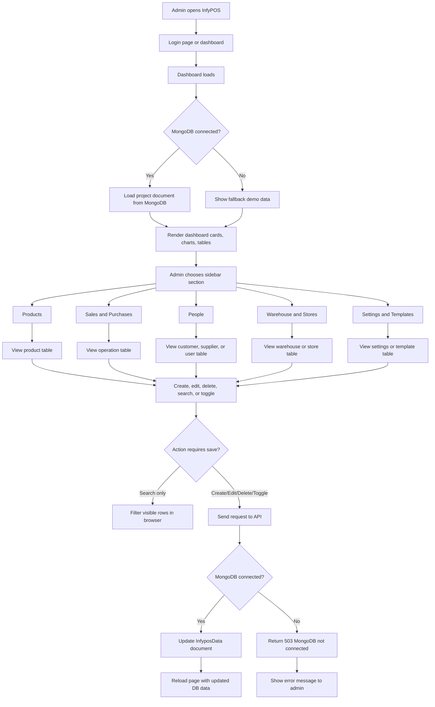
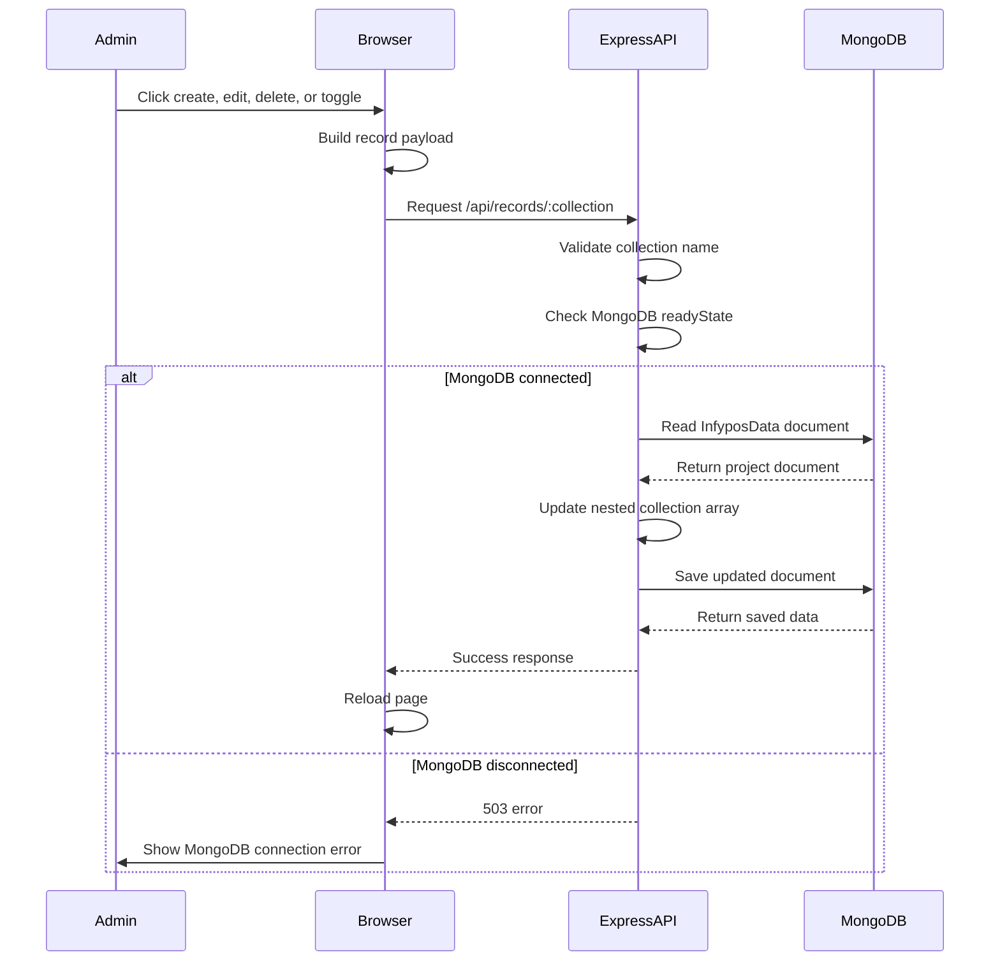
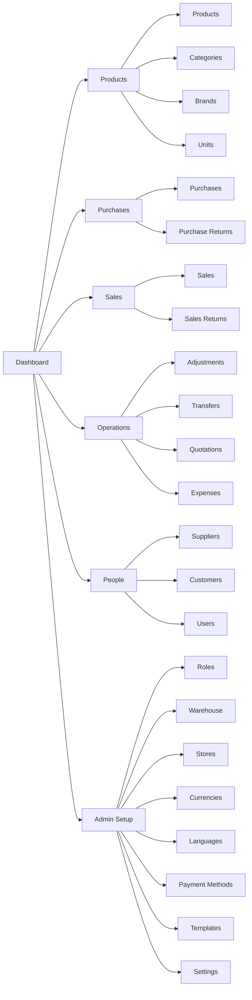
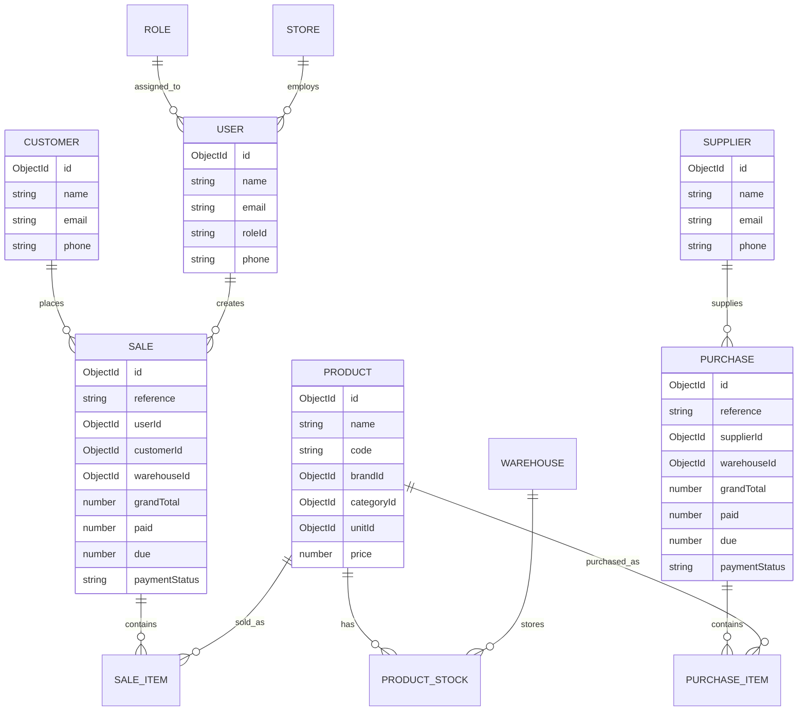

# InfyPOS ERD and User Flow

## 1. High-Level ERD

This project currently stores the app data in one main MongoDB document using the `InfyposData` model. The document is grouped into dashboard, product catalog, and operations data.

## 2. Detailed Data Relationship

## 3. Admin User Flow

## 4. Save Data Flow

## 5. Main Page Navigation Flow

## 6. Recommended Future ERD

For a larger production system, the current single-document structure should eventually be split into separate collections.

